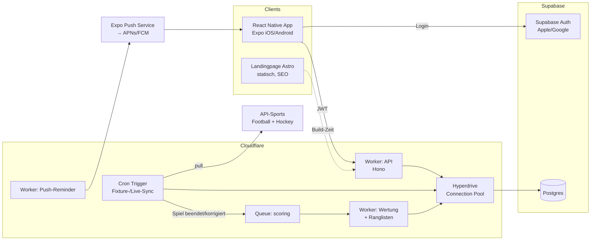
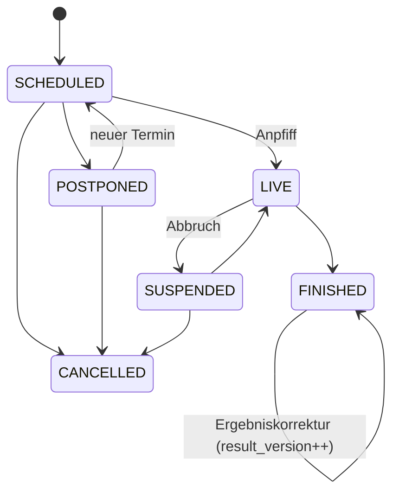

# Tippety – Technisches Architektur-Konzept

Stand: 17.10.2026 · Ziel: Hobby-Projekt, kein Echtgeld, **möglichst wartungsarm und günstig**.
Legende: ✅ verifiziert (Quelle verlinkt) · ⚠️ nicht verifiziert / vor Entscheidung prüfen

---

## 0. Kurzfassung (Empfehlung)

| Bereich | Empfehlung |
|---|---|
| App | React Native mit **Expo** (EAS Build, EAS Update/OTA, Expo Push) |
| Backend | **Cloudflare Workers** (Hono als API-Framework), Cron Triggers + Queues |
| Datenbank | **Supabase (Postgres)**, angebunden über Cloudflare Hyperdrive; Alternative: D1 |
| Auth | **Supabase Auth** (Sign in with Apple + Google), JWT im Worker prüfen |
| Sportdaten | **API-Sports** (API-Football + API-Hockey) als eine Quelle für beide Sportarten |
| Landingpage | **Astro** auf Cloudflare Pages/Workers, statisch generiert, täglicher Rebuild |
| Kosten Start | ca. 5–25 USD/Monat + Apple 99 USD/Jahr + Google 25 USD einmalig |

---

## 1. Gesamtarchitektur

Prinzipien: ein Repo (Monorepo: `apps/mobile`, `apps/web`, `workers/api`, `packages/shared`), eine Datenquelle, alles serverless, keine eigenen Server/VMs, keine Live-Websockets (App pollt bei offenem Live-Screen alle 30–60 s gecachte Daten).

---

## 2. Hosting: Cloudflare Workers vs. Vercel

| Kriterium | Cloudflare Workers | Vercel |
|---|---|---|
| Kosten | Free: 100k Requests/Tag; Paid **5 USD/Monat** inkl. 10 Mio. Requests ⚠️ (Preise vor Start prüfen: developers.cloudflare.com/workers/platform/pricing) | Hobby gratis, aber **laut AGB nicht kommerziell**; Pro 20 USD/User/Monat ⚠️ |
| Cron | Cron Triggers, minütlich möglich, auch im Free-Plan | Cron Jobs; im Hobby-Plan stark eingeschränkt (1×/Tag) ⚠️ |
| Queues / Hintergrundjobs | Cloudflare Queues (Paid-Plan) nativ | keine native Queue, extern nötig (z. B. Upstash QStash) |
| Cold Starts | praktisch keine (V8-Isolates) | Serverless Functions mit Cold Starts; Edge Runtime schnell, aber eingeschränkt |
| DB-Nähe | D1 nativ; Postgres via Hyperdrive (Pooling + Query-Cache) | gut mit Neon/Supabase über Marketplace |
| Wartung | wenig: `wrangler deploy`, kein Framework-Lock-in | sehr gut für Next.js, für reine API eher Overkill |
| Landingpage | Pages/Workers Static Assets gratis | exzellent für Next.js |

**Empfehlung: Cloudflare Workers.** Für eine reine API + Cron + Queue ist Cloudflare günstiger (5 USD fix), hat echte Cron-Jobs und Queues ohne Zusatzdienste und keine Cold Starts. Vercel spielt seine Stärken nur bei Next.js aus, das wir nicht brauchen.

---

## 3. Datenbank, Auth, Expo

### 3.1 Datenbank

| Option | Pro | Contra |
|---|---|---|
| **Supabase (Postgres)** | Auth inklusive, echte SQL-Features (Window Functions für Ranglisten, Materialized Views, Constraints), Dashboard, Backups | Free-Projekte pausieren nach Inaktivität ⚠️ → für Produktion Pro (~25 USD/Monat) ⚠️ |
| Cloudflare D1 (SQLite) | im Workers-Plan quasi gratis, null Latenz zum Worker | SQLite: keine Materialized Views, Auth separat nötig, Größenlimit pro DB ⚠️ |
| Neon (Postgres) | Scale-to-zero, Branching, großzügiger Free-Tier | Auth separat, Cold Start der DB nach Leerlauf |
| Turso (libSQL) | günstig, verteilte Replikas | kleineres Ökosystem, Auth separat |

**Empfehlung: Supabase Postgres + Supabase Auth** – ein Anbieter für DB + Login reduziert Wartung am stärksten; Ranglisten sind in Postgres trivial. Worker greift über **Hyperdrive** zu (Pooling). Budget-Alternative: **D1 + Better Auth** (fast 0 USD, aber mehr Eigenbau).

### 3.2 Auth
- **Supabase Auth**: Apple + Google nativ, kostenlos in hohen MAU-Grenzen ⚠️; App nutzt `expo-apple-authentication` + Google Sign-In → ID-Token an Supabase. Worker prüft JWT (JWKS).
- Clerk: komfortabel, aber zusätzlicher Anbieter/Kosten ab Wachstum.
- Better Auth: Open Source, selbst gehostet im Worker, keine Kosten, aber mehr Pflege.
- Pflicht: Apple verlangt Sign in with Apple, wenn Google-Login angeboten wird, und eine **Konto-Löschfunktion in der App**.

### 3.3 Expo – Bewertung: klar empfohlen
- **EAS Build**: iOS-Builds ohne eigenen Mac-Build-Server; Free-Tier mit begrenzten Builds ⚠️.
- **EAS Update (OTA)**: JS-/Design-Fixes ohne Store-Review – großer Wartungsvorteil.
- **Expo Push**: ein API für APNs + FCM, kostenlos ⚠️; Tokens in Tabelle `push_tokens`.
- Expo Router, Liquid-Glass-Look via `expo-blur`/native Module möglich.

---

## 4. Datenquellen Spielpläne & Ergebnisse

| Anbieter | Fußball-Ligen (EPL, LaLiga, BL, Serie A, L1, **AT-BL**) | Eishockey **Swiss National League** | Free-Tier / Preise | Bemerkung |
|---|---|---|---|---|
| **API-Sports** (API-Football / API-Hockey) | ✅ alle (alle Wettbewerbe in allen Plänen) | ✅ National League, Swiss League, Swiss Cup gelistet | ✅ Free 100 Req/Tag **pro API**, Free nur eingeschränkte Saisons; Football Pro 19 USD (7.500/Tag), Ultra 29 USD, Mega 39 USD; bezahlte Pläne prepaid, keine Auto-Verlängerung, keine Überziehungskosten | eine Quelle, ein Format für beide Sportarten; Hockey-Preise separat ⚠️ (ähnliches Modell erwartet) |
| football-data.org | ✅ Top-5 im Free-Tier; ⚠️ AT-Bundesliga nur in Bezahl-Tier (49/99/199 €) | ❌ kein Eishockey | Free mit Rate-Limit (ca. 10 Req/min ⚠️) | gut als Fallback für Top-5 |
| OpenLigaDB | ⚠️ v. a. deutsche Ligen, community-gepflegt | ❌ | gratis | nicht ausreichend |
| TheSportsDB | ⚠️ breite Abdeckung, Livescores nur Premium | ⚠️ | Free/Patreon-Modell ⚠️ | Qualität/Aktualität schwankend |
| Sportmonks | ✅ Fußball stark | ❌ kein Hockey ⚠️ | ab ca. 29–39 €/Monat ⚠️ | nur Fußball |
| SportDevs / Highlightly | ⚠️ multi-sport inkl. Hockey | ⚠️ nicht verifiziert | ⚠️ | nicht geprüft – vor Nutzung testen |

Quellen: [API-Football Pricing](https://www.api-football.com/pricing) · [API-Hockey Abdeckung](https://api-sports.io/sports/hockey) · [API-Sports](https://api-sports.io/) · [football-data.org Coverage](https://www.football-data.org/coverage)

**Lizenz/Nutzung:** ⚠️ Bei allen Anbietern vor Launch die AGB prüfen: Anzeige von Ergebnissen in einer öffentlichen App, Logo-/Wappen-Nutzung (Vereinswappen sind Markenrechte – **nicht vom API-Anbieter lizenziert**; Empfehlung: eigene neutrale Kürzel-Badges in Vereinsfarben), Caching und Weitergabe an die Landingpage.

**Empfehlung: API-Sports Football + Hockey, je Pro-Plan (~19 USD + ~? USD Hockey).** Free-Tier reicht zum Entwickeln, aber nicht für die aktuelle Saison. Requests-Budget: ~7 Ligen × wenige Calls/Stunde + Live-Polling nur während laufender Spiele → deutlich < 7.500/Tag. Adapter-Schicht (`ProviderAdapter`) so bauen, dass football-data.org als Fallback einsteckbar ist.

---

## 5. Ergebnis-Import & Abrechnung

### 5.1 Jobs
| Job | Takt | Aufgabe |
|---|---|---|
| `sync-fixtures` | 1×/Tag (z. B. 04:00) | Spielpläne nächste 30 Tage, Anstoßzeiten, Verschiebungen |
| `sync-live` | jede Minute, aber nur wenn Spiele im Fenster [Anstoß−5 min, Anstoß+3 h] | Status + Spielstand; nichts zu tun → 0 API-Calls |
| `sync-standings` | 1×/Tag + nach Spieltag | Tabellen (Landingpage) |
| `reconcile` | 1×/Tag | finale Ergebnisse der letzten 7 Tage erneut abgleichen (Korrekturen) |
| `push-reminders` | alle 15 min | Nutzer mit offenen Tipps, Anstoß in < 60 min |
| Queue `scoring` | eventgetrieben | Wertung eines Spiels + Ranglisten-Update |

### 5.2 Status-Maschine

- **POSTPONED**: Tipps bleiben gültig und editierbar bis zum neuen Anstoß.
- **CANCELLED**: Tipps werden mit 0 Punkten und Flag `void` neutralisiert (zählen nicht in Trefferquote).
- Mapping Provider-Status (z. B. `NS`, `1H`, `FT`, `AOT`, `AP`, `PST`, `CANC`) → eigener Status im Adapter.

### 5.3 Idempotente Wertung
- `matches.result_version` erhöht sich bei jeder Ergebnisänderung von FINISHED-Spielen.
- Scoring-Job: `score_match(match_id, result_version)` → berechnet Punkte aller Tipps, schreibt per **UPSERT** in `tip_scores (tip_id) … scored_version`. Läuft er doppelt, ist das Ergebnis identisch.
- Korrektur = neue Version → gleiche Funktion überschreibt Punkte, Ranglisten werden für betroffene Zeiträume neu aggregiert. Optional Push „Ergebnis korrigiert“.
- Erst nach Status FINISHED **+ 15 min Karenz** final werten (Provider korrigieren oft kurz nach Abpfiff); Live-Punkte in der App nur als „vorläufig“ anzeigen (clientseitig berechnet).

### 5.4 Eishockey: welches Ergebnis zählt?
**Vorschlag: Ergebnis nach regulärer Spielzeit (60 min) zählt**, wie bei Wettanbietern üblich. Unentschieden ist damit tippbar (spannender, analog Fußball). Verlängerung/Penalty fließen nicht ein; die App zeigt das Endergebnis trotzdem an („2:2 n. R., 3:2 n. P.“). Daher Felder `home_regular`, `away_regular` getrennt von `home_final`, `away_final`. Alternative (offene Entscheidung): Endergebnis inkl. OT/Penalty, dann kein Unentschieden.

### 5.5 Punktesystem (Vorschlag, konfigurierbar pro Sportart)
Exaktes Ergebnis 4 · richtige Tordifferenz 3 · richtige Tendenz 2 · sonst 0. Regeln in Tabelle `scoring_rules` (versioniert), nicht im Code hart verdrahtet.

### 5.6 Tippschluss serverseitig
- Insert/Update auf `tips` nur, wenn `now() < matches.kickoff_at` **und** Status = SCHEDULED/POSTPONED – geprüft im Worker **und** per Postgres-Trigger/RLS (doppelte Absicherung).
- Kickoff-Zeit immer aus DB, nie vom Client. Tipps anderer erst nach Anstoß sichtbar (RLS-Policy).

### 5.7 Ranglisten (materialisiert)
- Tabelle `leaderboard_entries (scope_type, scope_id, period, user_id, points, exact_hits, tips_count, rank)` – scope = global | sport | league | group; period = season | month | matchday.
- Nach jeder Wertung: inkrementell für betroffene Nutzer aktualisieren, `rank` per `RANK() OVER (...)` neu setzen; nächtlicher Voll-Rebuild als Sicherheitsnetz.
- Gruppen-Ranglisten = Filter auf Mitglieder, gleiche Logik. App liest nur fertige Zeilen (schnell, cachebar).

---

## 6. Datenmodell (grob)

| Tabelle | Wichtige Felder |
|---|---|
| `users` | id (= auth uid), display_name, avatar_url, favorite_sport, created_at |
| `sports` | id (football, hockey) |
| `leagues` | id, sport_id, name, country, provider_league_id, slug, active |
| `seasons` | id, league_id, year, current |
| `teams` | id, sport_id, name, short_name, colors, provider_team_id, slug |
| `matches` | id, season_id, home_team_id, away_team_id, kickoff_at, status, matchday, home_regular, away_regular, home_final, away_final, decided_by (REG/OT/SO), result_version, provider_match_id, updated_at |
| `tips` | id, user_id, match_id, home, away, created_at, updated_at · UNIQUE(user_id, match_id) |
| `tip_scores` | tip_id, points, category (exact/diff/tendency/miss/void), scored_version |
| `scoring_rules` | id, sport_id, version, json_rules, valid_from |
| `groups` | id, name, owner_id, invite_code, league_filter[], created_at |
| `group_members` | group_id, user_id, role, joined_at |
| `leaderboard_entries` | siehe 5.7 |
| `push_tokens` | user_id, expo_token, platform, updated_at |
| `notification_prefs` | user_id, reminder_minutes, results, group_activity |
| `sync_runs` | job, started_at, finished_at, api_calls, error (Monitoring) |

Invite-Link: `https://tippety.app/g/<invite_code>` → Universal Link/App Link öffnet App, sonst Store-Weiterleitung.

---

## 7. Landingpage

- **Astro** (statisch, `output: static`), Hosting **Cloudflare Pages/Workers Static Assets** (gratis).
- Seiten aus DB generiert zur Build-Zeit: `/fussball/premier-league`, `/eishockey/national-league`, je Liga Spielplan, Tabelle, Teams (`/teams/zsc-lions`).
- **Täglicher Rebuild** per Deploy-Hook aus dem Cron-Worker (oder GitHub Action) → kein Server-Rendering, kaum Wartung.
- SEO: strukturierte Daten (`SportsEvent`, `SportsTeam`), Sitemap, hreflang (de-AT, de-CH, de-DE), schnelle Core Web Vitals. Smart App Banner + Store-Badges.
- ⚠️ Lizenz prüfen, ob Spielpläne/Tabellen des Datenanbieters öffentlich im Web dargestellt werden dürfen.

---

## 8. Kosten, Wartung, Risiken

### 8.1 Kosten (monatlich, Schätzung ⚠️)
| Posten | Start/Entwicklung | 1.000 Nutzer | 10.000 Nutzer |
|---|---|---|---|
| Cloudflare Workers Paid | 0–5 USD | 5 USD | 5–10 USD |
| Supabase | 0 (Free) | 25 USD (Pro, kein Pausieren) | 25–40 USD |
| API-Sports Football | 0 (Free, alte Saisons) | 19 USD | 19–29 USD |
| API-Sports Hockey | 0 | ~10–20 USD ⚠️ | ~10–30 USD ⚠️ |
| Expo EAS | 0 | 0 | 0–19 USD (falls mehr Builds/Updates nötig) ⚠️ |
| Domain | ~1–2 USD | ~1–2 USD | ~1–2 USD |
| **Summe** | **~0–7 USD** | **~60–70 USD** | **~60–130 USD** |
| Einmalig/jährlich | Apple Developer 99 USD/Jahr, Google Play 25 USD einmalig | | |

Treiber sind die Sportdaten, nicht die Infrastruktur. Last ist minimal (Tipps sind kleine Writes).

### 8.2 Wartungsaufwand
- Laufend: ~1–2 h/Monat (Monitoring `sync_runs`, Alerts via Mail bei Job-Fehlern).
- Saisonwechsel (2×/Jahr wegen unterschiedlicher Saisons Fußball/Hockey): neue `seasons` anlegen, IDs prüfen, Playoff-Modus der National League beachten (~2–4 h).
- Jährlich: Expo-SDK-Upgrade, Store-Anforderungen (~1 Tag).

### 8.3 Risiken
| Risiko | Gegenmaßnahme |
|---|---|
| Datenanbieter fehlerhaft/verspätet, Preisänderung | Adapter-Schicht, Fallback football-data.org, manuelles Admin-Override für Ergebnisse |
| Lizenz (Daten-Anzeige, Vereinswappen) | AGB prüfen, eigene Badges statt Logos |
| Store-Review (Glücksspiel-Verdacht) | klar „kein Echtgeld, keine Wetten, keine Quoten“ kommunizieren; keine Odds anzeigen |
| DSGVO | Datenschutzerklärung, Konto-Löschung, EU-Region bei Supabase (Frankfurt) |
| Missbrauch (Fake-Accounts in globaler Rangliste) | nur Apple/Google-Login, Rate-Limits im Worker |
| Supabase Free pausiert | ab Launch Pro oder Keep-alive |

---

## 9. Offene Entscheidungen für Markus

1. **Eishockey-Wertung**: Ergebnis nach 60 min (Empfehlung) oder Endergebnis inkl. OT/Penalty?
2. **Punktesystem**: 4/3/2/0 übernehmen oder eigenes (z. B. Joker/Doppelpunkte)?
3. **DB**: Supabase (Komfort, ~25 USD) vs. D1 + Better Auth (≈0 USD, mehr Eigenbau)?
4. **Datenbudget**: API-Sports Football + Hockey kostenpflichtig ab Launch ok (~30–50 USD/Monat)?
5. **Weitere Wettbewerbe** (Champions League, ÖFB-Cup, ICE Hockey League, NHL)? Bei API-Sports ohne Mehrkosten.
6. **Ranglisten-Zeiträume**: Saison, Monat, Spieltag – alle oder nur Saison?
7. **Domain** (z. B. tippety.app) und Store-Accounts (privat, nicht Firma).
8. **Logos/Wappen**: neutrale Badges (Empfehlung) oder Lizenzklärung?
